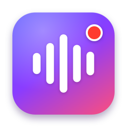
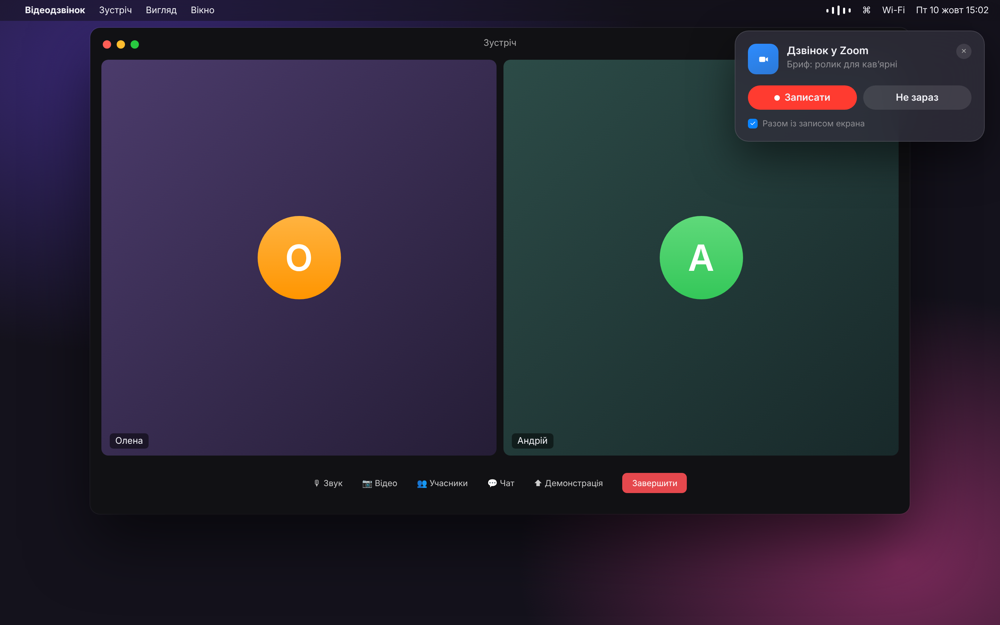
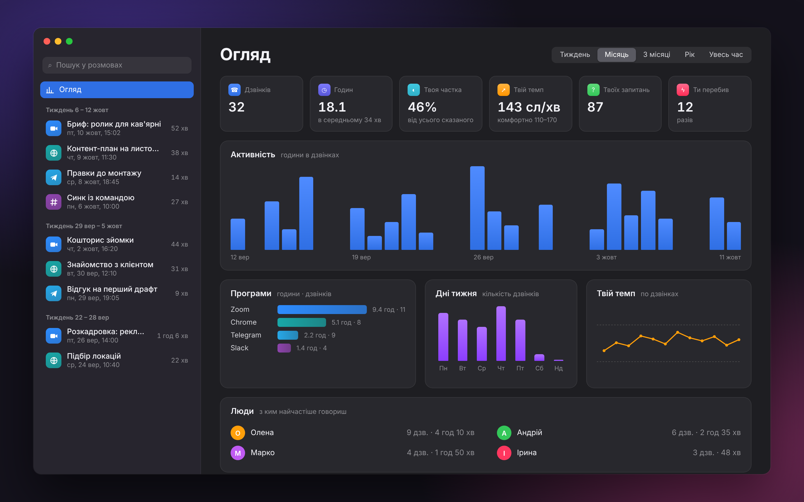
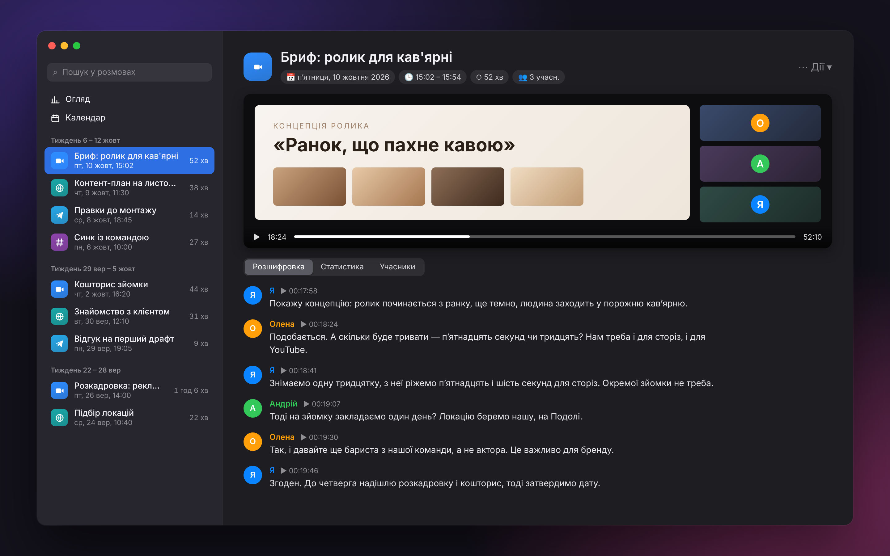
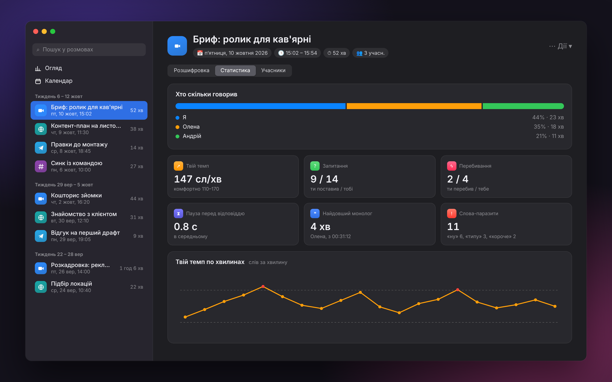
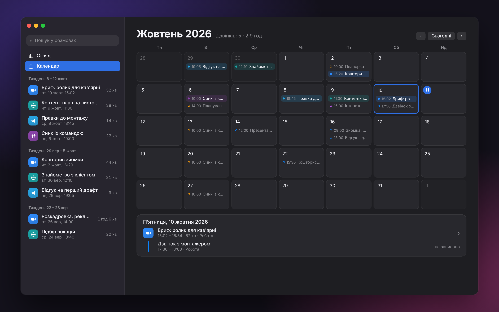

<div align="center">



# Rozmova

**Записує дзвінки з будь-якої програми на Маці й розшифровує їх прямо на ньому.**<br>
Без бота в дзвінку, без лімітів на хвилини й без підписки.

**[slavashootit.github.io/rozmova](https://slavashootit.github.io/rozmova/)**

[](https://github.com/slavashootit/rozmova/releases/latest)




</div>

## Навіщо

Сервіси-нотатники на кшталт Read.ai чи Otter зазвичай додають у дзвінок бота, підтримують
кілька популярних платформ, обмежують безкоштовні хвилини й хочуть щомісячну оплату. Rozmova
влаштована інакше. Вона живе в меню-барі, сама помічає дзвінок у **будь-якій** програмі
(Zoom, Google Meet у браузері, Telegram, Slack, FaceTime, WhatsApp, Discord, Teams…), пише
твій голос і співрозмовників, а потім розшифровує розмову на твоєму Маці. Записи й тексти
нікуди не відправляються.

## Що вміє

- **Сама помічає дзвінок.** Щойно програма відкриває мікрофон для розмови, справа зверху
  виїжджає віконце «Записати?». Фокус у дзвінка воно не забирає. А ⌃⌥R починає чи зупиняє
  запис із будь-якої програми. Програми для диктування
  (Superwhisper, MacWhisper, Wispr Flow) дзвінком не вважаються.
- **Пише обидві сторони окремо.** Твій мікрофон і звук системи йдуть на різні доріжки, тож
  у розшифровці точно видно, де говориш ти.
- **Розрізняє співрозмовників за голосом:** «Співрозмовник 1», «Співрозмовник 2»… Імена
  можна вписати, і вони потраплять у текст. Назвеш людину раз, і в наступних дзвінках Rozmova
  впізнає її голос сама.
- **Записує екран**, якщо треба: 30 кадрів/с, зі звуком розмови. Головний дисплей, інший
  монітор або лише вікно Zoom чи Meet, тоді демонстрацію співрозмовника видно завжди.
- **Розшифровує локально.** NVIDIA Parakeet на Neural Engine, 25 європейських мов, зокрема
  українська. Безкоштовно й без інтернету. Якщо хочеш хмару, є Groq.
- **«Мої дзвінки»:** усі розмови в одному вікні. Пошук по тексту всіх дзвінків відкриває
  потрібну репліку, клік на репліку вмикає запис із цього місця, плюс статистика.
- **Статистика без нейронок:** хто скільки говорив, твій темп мовлення, запитання,
  перебивання, паузи, найдовший монолог, слова-паразити. Плюс огляд за тиждень, місяць чи
  рік.
- **Календар дзвінків:** місяць дзвінків по днях, а поруч зустрічі з Календаря macOS. Дзвінок, що
  йшов під час події, отримує її назву замість «Дзвінок у Zoom», а за хвилину до онлайн-зустрічі
  (подія з посиланням на Zoom, Meet, Teams чи FaceTime) приходить нагадування. Календар лише
  читається.
- **Сам прибирає за собою.** Технічні файли видаляються через 2 тижні, а відео, аудіо й
  розшифровки лишаються назавжди.

<div align="center">



<sub>Огляд за місяць: скільки часу в дзвінках, у яких програмах, як змінюється твій темп і з ким говориш найчастіше</sub>



<sub>Дзвінок: відео екрана зі звуком і розшифровка. Клік на час репліки вмикає запис із цього місця</sub>



<sub>Статистика одного дзвінка: частка розмови, темп по хвилинах, запитання й перебивання</sub>



<sub>Календар: дзвінки по днях і зустрічі з Календаря macOS — видно, що записано, а що ні</sub>

</div>

<sub>Знімки екрана — макети з вигаданими даними.</sub>

## Порівняння

| | Rozmova | Типовий сервіс-нотатник |
|---|:---:|:---:|
| Бот приєднується до дзвінка | ні | часто так |
| Будь-яка програма для дзвінків | ✓ | зазвичай кілька популярних |
| Ліміт хвилин | немає | на безкоштовному плані є |
| Підписка | немає | так |
| Де зберігаються записи | на твоєму Маці | у хмарі сервісу |
| Розшифровка без інтернету | ✓ | — |

## Встановлення

1. Завантаж [**Rozmova.dmg**](https://github.com/slavashootit/rozmova/releases/latest/download/Rozmova.dmg).
2. Відкрий його й перетягни **Rozmova** у **Програми**.

   Або все одним рядком у Терміналі (скачає, покладе в «Програми» й запустить):
   ```bash
   curl -fsSL https://slavashootit.github.io/rozmova/install.sh | bash
   ```
3. Програма не нотаризована Apple (для цього потрібен платний акаунт розробника), тож під час
   першого запуску macOS її заблокує. Відкрий **Системні параметри → Приватність і безпека**,
   прогорни вниз і натисни **«Усе одно відкрити»**. Або одною командою в Терміналі:
   ```bash
   xattr -dr com.apple.quarantine /Applications/Rozmova.app
   ```
4. Під час першого запуску дозволь:
   - **Мікрофон**, щоб писати твій голос;
   - **Запис екрана та системного звуку** (macOS спитає на першому записі), щоб писати
     співрозмовників. Після цього перезапусти програму;
   - **Сповіщення**, щоб бачити «Запис збережено» й «Розшифровка готова»;
   - за бажанням **Календар** («Мої дзвінки» → «Календар» → «Підключити»), щоб бачити зустрічі
     поруч із дзвінками й називати записи за подіями.

Під час першої розшифровки програма один раз скачає модель розпізнавання, приблизно 0,6 ГБ.

**Потрібно:** macOS 14 або новіша, Mac на Apple Silicon (M1 і новіші).

## Де лежать файли

Відео й аудіо лежать у теці записів (за замовчуванням `~/Documents/Calls`, змінюється в
налаштуваннях). Кожен дзвінок займає окрему теку:

```
Call_2026-10-10_15-02/
  Call_2026-10-10_15-02.mp4   запис екрана зі звуком розмови
  Call_2026-10-10_15-02.m4a   аудіо: ти й співрозмовники в одному файлі
```

Розшифровки (`.txt`) і статистика зберігаються в програмі, кілька КБ на дзвінок:
`~/Library/Application Support/Rozmova/History/`. Найзручніше дивитися їх у «Мої дзвінки».
Розшифровка — звичайний текст:

```
[00:18:24] Олена: А скільки буде тривати — пʼятнадцять секунд чи тридцять?

[00:18:41] Я: Знімаємо одну тридцятку, з неї ріжемо пʼятнадцять і шість секунд.
```

## Як це влаштовано

| Що | Чим |
|---|---|
| Помітити дзвінок | Core Audio: яка програма зараз тримає мікрофон |
| Звук співрозмовників і екран | ScreenCaptureKit |
| Твій голос | AVAudioEngine, окрема доріжка на спільній шкалі часу |
| Розшифровка | [FluidAudio](https://github.com/FluidInference/FluidAudio) + NVIDIA Parakeet на Neural Engine, або Groq API |
| Хто з інших говорить | FluidAudio: pyannote + WeSpeaker + VBx, локально |
| Статистика | лише таймкоди слів і підрахунки, без мовних моделей |

Програма написана на Swift і SwiftUI, живе в меню-барі й не має іконки в Доку.

## Зібрати з коду

Потрібні Command Line Tools (`xcode-select --install`) зі Swift 6.

```bash
git clone https://github.com/slavashootit/rozmova.git
cd rozmova
./build.sh
```

`build.sh` збирає програму, кладе її в `~/Applications` і запускає. Щоб macOS не питала
дозволи після кожної збірки, підпиши програму сталим сертифікатом: створи в Keychain Access
самопідписаний сертифікат для підпису коду з назвою `Rozmova Dev`, і скрипт знайде його сам.
DMG збирається командою `./scripts/package.sh`. Релізи на GitHub збираються автоматично,
щойно з'являється тег `v*`.

Для розробки: віконце «Записати?» без справжнього дзвінка й лог програми.

```bash
pkill -x Rozmova; open ~/Applications/Rozmova.app --args --demo-prompt
log stream --predicate 'subsystem == "com.slava.rozmova"'
```

## Чесно про обмеження

- Rozmova пише твій мікрофон навіть тоді, коли в програмі дзвінка ввімкнений mute. Тож у
  розшифровку може потрапити те, чого співрозмовники не чули.
- Розділення співрозмовників за голосом — здогадка: схожі голоси можуть злитися в один.
- Записується головний дисплей. Презентація на другому моніторі в кадр не потрапить.
- У навушниках розшифровка чистіша, ніж через колонки.

**Попереджай людей, що дзвінок записується.** У багатьох країнах це вимога закону.

## Ліцензія

[MIT](LICENSE) © 2026 Viacheslav Yermolenko
